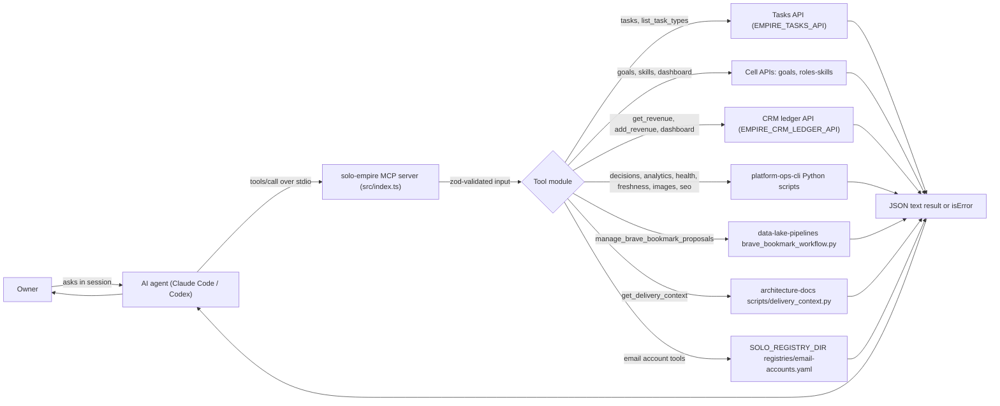
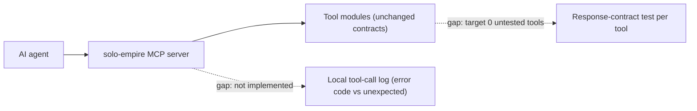

# 01 — Business process (As-Is / To-Be)

`platform-mcp-aggregator` คือ local MCP server (stdio, TypeScript) ชื่อ `solo-empire` v1.0.0 ที่ให้ AI agents ของ owner
(Claude Code, Codex ฯลฯ) เรียก typed tools แทนการเข้าถึง database หรือ shell เอง ไม่มี hosted runtime และไม่มี database ของตัวเอง:
ทุก tool เป็น thin adapter ที่เรียก HTTP API ของ cell/CRM หรือ subprocess ไปยัง script ใน repo เจ้าของข้อมูล

## As-Is (จากโค้ดวันนี้)

Sources: `src/index.ts`, `src/tools/*.ts`, `src/task-store.ts`, `src/cell-store.ts`, `src/crm-ledger.ts`, `src/delivery-context.ts`, `src/email-accounts.ts`, `PRODUCT.md`, `README.md`

ขั้นตอนที่มี human gate ในโค้ด:
- decision tools (`approve_decision`, `reject_decision`, `defer_decision`, `complete_decision`, `review_decision`) ต้องส่ง `confirm=true` มิฉะนั้นคืน `success:false` และไม่เปลี่ยนสถานะ (`src/tools/decisions.ts`)
- `sync_decision_reviews` ค่าเริ่มต้นเป็น `--dry-run`; `fetch_free_images` และ `seo_monthly_report` ไม่เขียนไฟล์จนกว่า `apply=true`
- `manage_brave_bookmark_proposals` สร้างแค่ proposal; การเขียน Brave profile จริงทำโดย scheduled job นอก repo นี้ (`src/tools/browser-bookmarks.ts`)

## To-Be

แหล่ง To-Be ที่อนุญาตมีเพียง `PRODUCT.md` (ไม่มี `specs/`, `docs/UPGRADE-PLAN.md` ใน repo). สิ่งที่ PRODUCT.md ระบุเป็นเป้าหมาย:
- วัด "tool calls ที่ fail ด้วย unexpected error แทน defined error code" — ต้องมี local call logging ซึ่งยังไม่มี (`[ต้องยืนยัน]` ใน PRODUCT.md)
- Tools ที่ไม่มี test ของ response contract = 0 (ปัจจุบันยังไม่ถึง ดู 17-test-coverage-matrix.md)
- `task check` เขียวบน `main` เสมอ

Sources: `PRODUCT.md` (Measures)

## Open questions
- จะเก็บ local call logging ที่ไหน และไม่ส่ง tool arguments ออกนอกเครื่องอย่างไร (PRODUCT.md ห้าม third-party reporter)
- ไม่มี To-Be อื่นใน repo (ไม่มี issues ที่อ่านได้ระบุแผน) — owner ต้องยืนยัน roadmap
