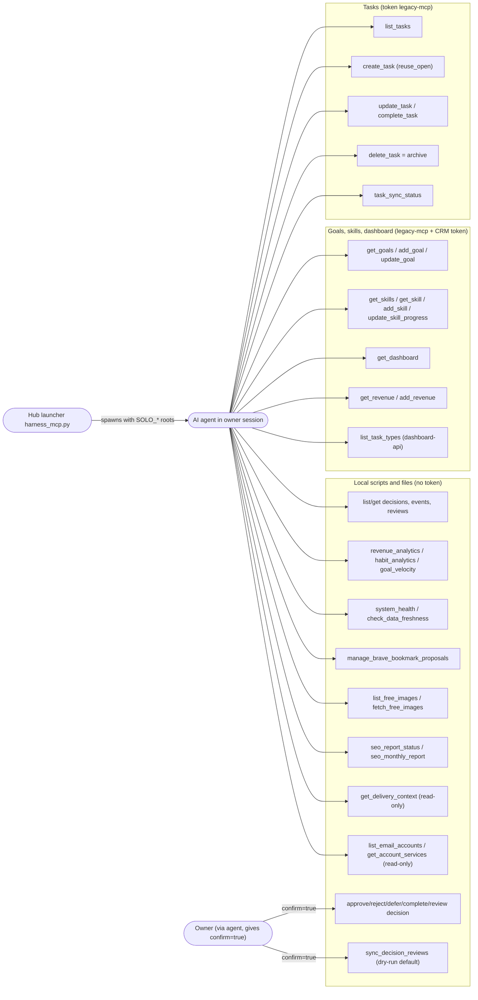

# 02 — Use cases

ไม่มี user login ใน server นี้: actor คือ process ที่ต่อ stdio (AI agent ใน session ของ owner) ซึ่งได้รับ env/token ของ owner จาก launcher.
"ระดับสิทธิ์" ที่เห็นในโค้ดคือ automation token ที่แต่ละ tool ใช้เรียก API ปลายทาง:
- `legacy-mcp` — tasks tools, goals, skills, dashboard (`src/tools/tasks.ts`, `goals.ts`, `skills.ts`, `dashboard.ts`)
- `dashboard-api` — `list_task_types` (`src/tools/customization.ts`)
- CRM owner token (`EMPIRE_CRM_LEDGER_TOKEN` หรือ `~/.config/solo-crm/income.token`) — revenue และ revenue ส่วนของ dashboard (`src/crm-ledger.ts`)
- ไม่มี token (local subprocess / file read) — decisions, analytics, health, freshness, bookmarks, images, SEO, delivery context, email accounts

Sources: `src/index.ts`, `src/tools/*.ts`, `src/crm-ledger.ts`, `src/task-store.ts` (`automationToken`), `~/bookchaowalit-empire/infra/scripts/agent/harness_mcp.py` (hub launcher, read-only)

รวม 40 tools จาก 15 modules (นับจาก `server.tool` / `server.registerTool` ใน `src/tools/`).

## Open questions
- `habits-store.ts` มี client สำหรับ log habit แต่ไม่มี MCP tool ที่ลงทะเบียน (มีแค่ `habit_analytics` ผ่าน Python) ทั้งที่ PRODUCT.md เขียนว่า "log a habit" — ตั้งใจหรือ gap?
- "confirm" มาจาก agent เอง ไม่มีการพิสูจน์ว่า owner กดยืนยันจริง (ดู 13-threat-model.md)
