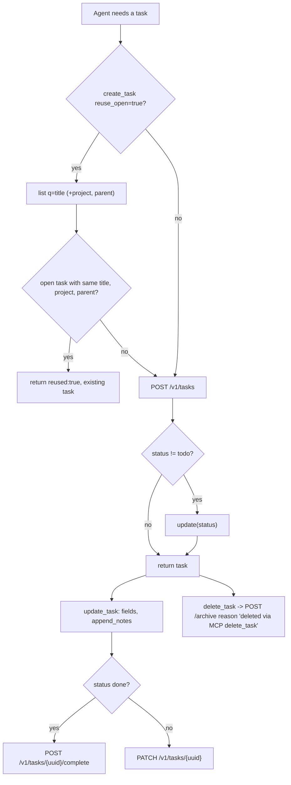
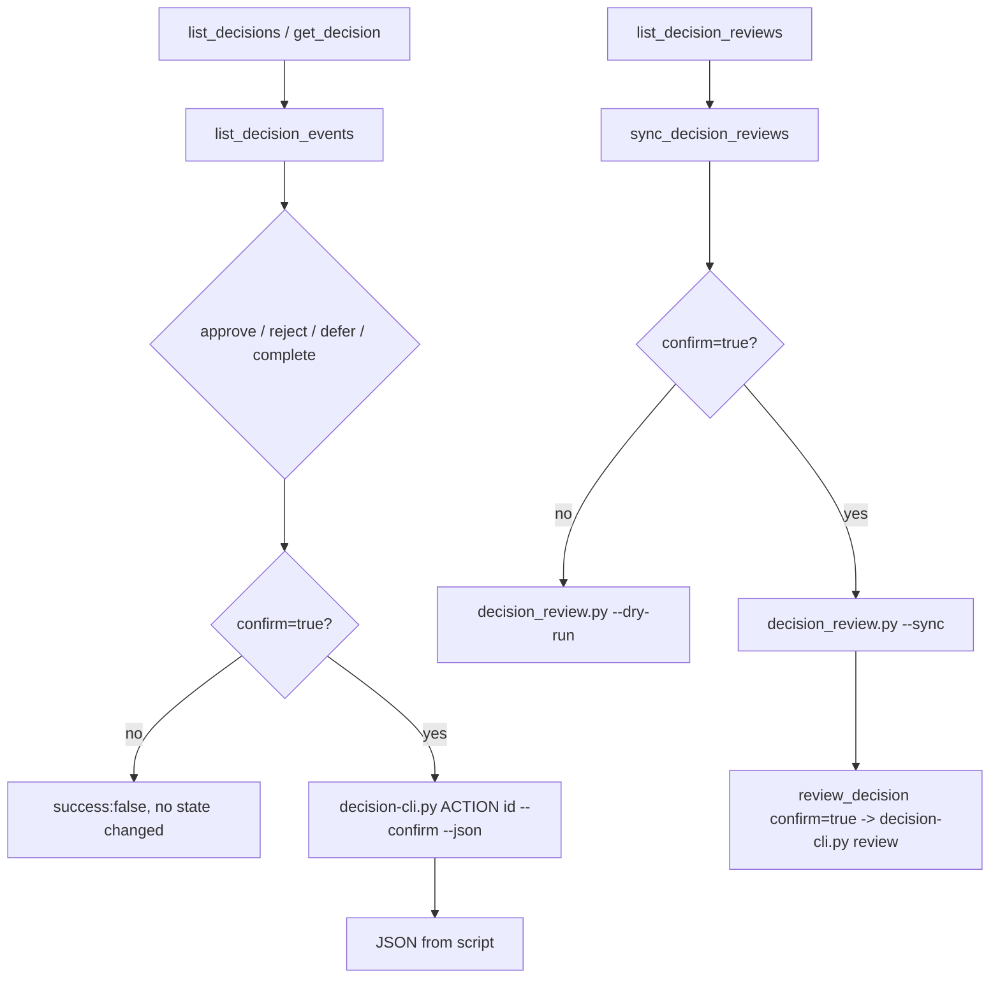
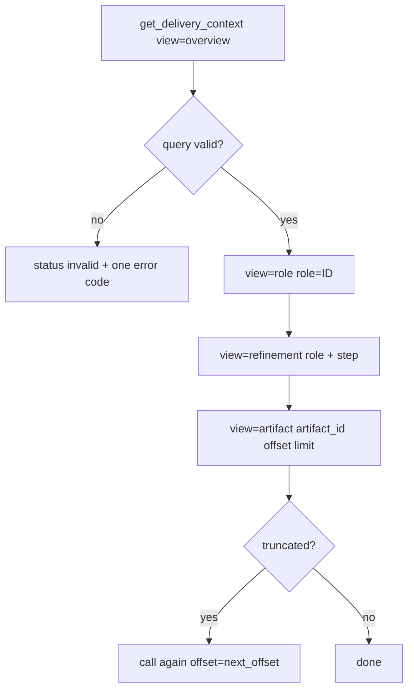
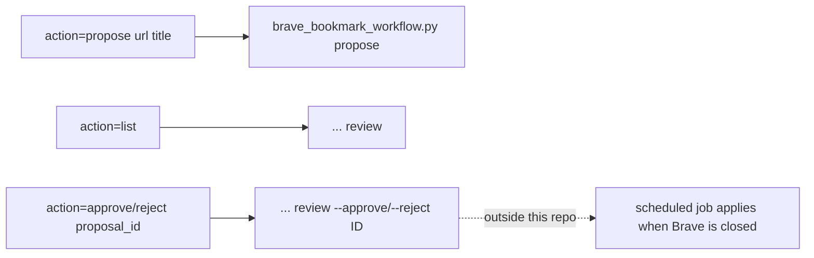

# 03 — User flows

ไม่มี UI/routes: "flow" คือลำดับ tool calls ของ agent. มี role เดียวในทางปฏิบัติ (agent ใน session owner).

## Flow A — จัดการ task (create → update → complete / archive)

Sources: `src/tools/tasks.ts`, `src/task-store.ts` (`ApiTaskStore.create/update/complete/archive`), `src/task-state.ts` (`updateTask`, `planTaskUpdate`)

## Flow B — decision approval (human gate)

Sources: `src/tools/decisions.ts`

## Flow C — delivery context (read-only, fail closed)

Sources: `src/delivery-context.ts` (`validateQuery`, `DATA_KEYS.artifact`), `README.md` (Delivery context)

## Flow D — bookmark proposal

Sources: `src/tools/browser-bookmarks.ts`

## Open questions
- ไม่มี flow สำหรับ habit logging ใน MCP (ดู 02)
