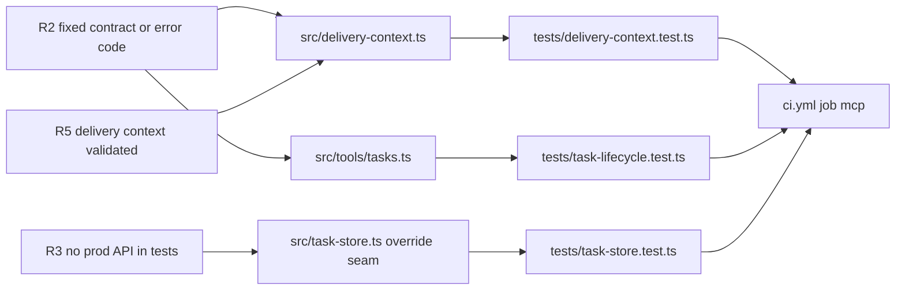

# 04 — Traceability (RTM)

Requirements มาจาก `PRODUCT.md` เท่านั้น (ไม่มี `specs/`). Release ทุกแถว = `.github/workflows/ci.yml` (job `mcp` + `security`) บน push to `main`; ไม่มี deploy step (ดู 16).

| ID | Requirement (PRODUCT.md) | Code module | Test file | Release / workflow | Status |
|---|---|---|---|---|---|
| R1 | Typed, validated tools (no raw DB / ad-hoc shell / guessed paths) | `src/tools/*.ts` (zod schemas), `src/roots.ts` | `tests/task-lifecycle.test.ts`, `tests/delivery-context.test.ts`, `tests/email-accounts.test.ts` | ci.yml `mcp` | partial: 11 modules have no tool test |
| R2 | Every tool answers with a fixed contract or clear error code | `src/delivery-context.ts` (`ADAPTER_CODES`, `EXPORTER_CODES`), `src/tools/tasks.ts` (`isError`), `src/crm-ledger.ts` (`ledgerSection`) | `tests/delivery-context.test.ts`, `tests/task-lifecycle.test.ts` ("missing MCP tasks and empty updates are explicit tool errors"), `tests/crm-ledger.test.ts` | ci.yml `mcp` | partial: Python-backed tools throw raw stderr (first 500 chars) |
| R3 | Nothing reaches a production API from tests | `src/task-store.ts` / `src/cell-store.ts` (`override*ForTests`), `tests/support/sqlite-*.ts` | `tests/task-store.test.ts`, `tests/task-lifecycle.test.ts`, `tests/habits-store.test.ts` | ci.yml `mcp` | implemented; ci.yml does not set `EMPIRE_CLIENT_CONFIG=/nonexistent` globally, tests set it per case |
| R4 | Thin adapter: caller's own token to cell/CRM APIs, or owning repo scripts via `SOLO_*_ROOT` | `src/task-store.ts` (`automationToken`), `src/cell-store.ts`, `src/crm-ledger.ts`, `src/roots.ts`, `src/index.ts` (`runPyScript`) | `tests/task-store.test.ts` (token lookup, redirects), `tests/crm-ledger.test.ts`, `tests/delivery-context.test.ts` ("architecture checkout uses the explicit owner root or a sibling") | ci.yml `mcp` | implemented; `cell-store.ts` has no direct test |
| R5 | `get_delivery_context` read-only, validates contract `solo-empire.delivery-context.v1` and source SHA256 | `src/delivery-context.ts`, `src/tools/delivery-context.ts` | `tests/delivery-context.test.ts` (27 tests) | ci.yml `mcp` | implemented |
| R6 | Callers cannot set roots, paths, commands or env; missing script fails clearly | `src/delivery-context.ts` (scrubbed env, `safePath`), `src/index.ts` (`script not found`), `src/tools/browser-bookmarks.ts` | `tests/delivery-context.test.ts` ("missing exporter and disallowed or symlinked roots never spawn") | ci.yml `mcp` | partial: `seo_monthly_report` accepts caller file paths `gsc`, `ahrefs`, `ga4` passed to the script |
| R7 | Tool names, schemas, response contracts backward compatible | `src/task-store.ts` (`legacyTaskRow`, `legacyTaskTypeRow`) | `tests/task-store.test.ts` ("MCP list_task_types keeps its old output"), `tests/task-lifecycle.test.ts` | ci.yml `mcp` | partial: no snapshot of `tools/list` |
| R8 | Email registry tools read-only, evidence + confidence kept | `src/email-accounts.ts`, `src/tools/email-accounts.ts` | `tests/email-accounts.test.ts` | ci.yml `mcp` | implemented |
| R9 | Out of scope: creating approvals, sending client documents, hosted deployment | `src/tools/decisions.ts` (records only), `src/tools/seo-report.ts` (never sends) | none | — | by design; not tested |
| M1 | Measure: unexpected-error rate | none | none | — | gap (needs local call logging) |
| M2 | Measure: `task check` green on `main` | `Taskfile.yml` | all | ci.yml | CI `mcp/node` green; last 2 main runs failed on `security` (see 15) |

Sources: `PRODUCT.md`, `src/**`, `tests/**`, `.github/workflows/ci.yml`, `Taskfile.yml`

## Open questions
- ควรมี requirement IDs ทางการใน PRODUCT.md หรือ specs/ หรือไม่ (ตอนนี้ R1–R9 ตั้งขึ้นในเอกสารนี้)
