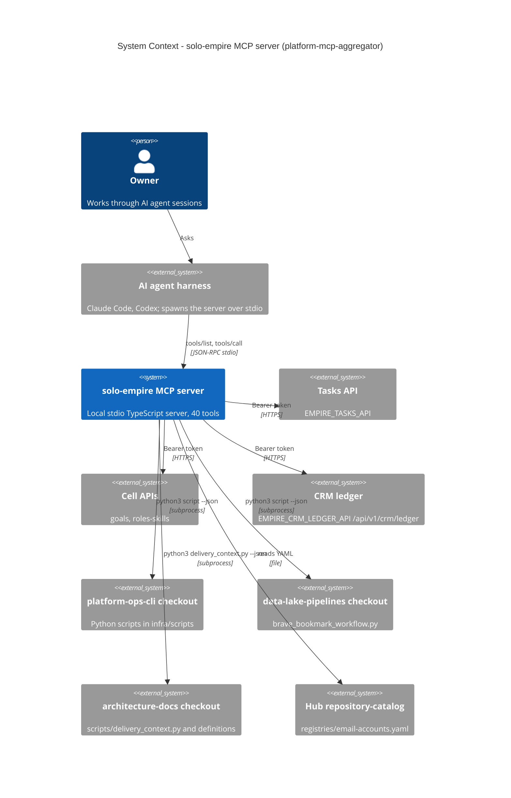

# 05 — C4 Context

Sources: `src/index.ts`, `src/task-store.ts`, `src/cell-store.ts`, `src/crm-ledger.ts`, `src/roots.ts`, `src/delivery-context.ts`, `src/email-accounts.ts`, `PRODUCT.md`

Remote counterpart (ไม่ใช่ dependency ของ repo นี้): Cloudflare Worker tool hub `platform-mcp-remote-worker` (`PRODUCT.md`, `docs/README.md`).
Python scripts อาจเรียก external services ต่อ (เช่น Openverse/Pexels/Unsplash ตาม description ของ `fetch_free_images`, Gmail สำหรับ `seo_monthly_report source=gmail`) — อยู่นอก repo นี้.

## Open questions
- ปลายทางจริงของ Python scripts แต่ละตัว (DB/API ไหน) ต้องดูใน `platform-ops-cli`
