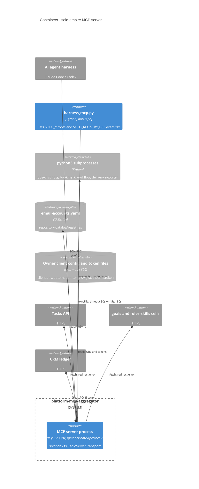

# 06 — C4 Container

Process เดียว (Node.js ผ่าน `tsx`) ไม่มี container/DB ของตัวเอง. Containers ด้านล่างคือ process และ store ที่มันคุยด้วย.

Sources: `src/index.ts`, `src/task-store.ts` (`clientConfigPath`, `automationToken`), `src/crm-ledger.ts` (`ledgerToken`, `AbortSignal.timeout(30_000)`), `src/tools/free-images.ts`, `src/delivery-context.ts`, `.github/workflows/ci.yml` (`node-version: "22"`), `~/bookchaowalit-empire/infra/scripts/agent/harness_mcp.py` (read-only)
