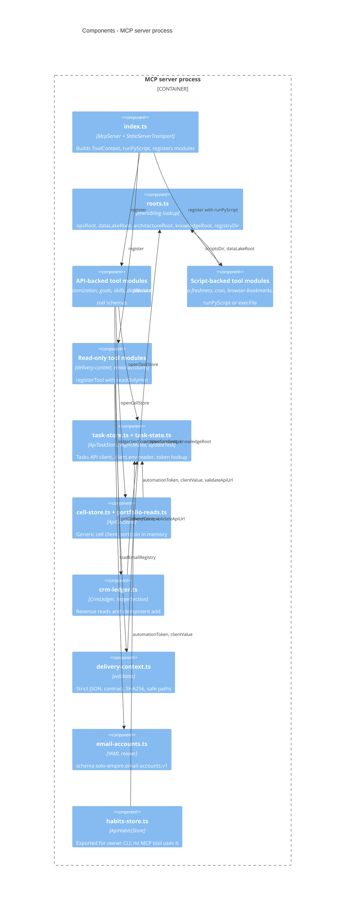

# 07 — C4 Component

Sources: `src/index.ts`, `src/roots.ts`, `src/tool-context.ts`, `src/tools/*.ts`, `src/task-store.ts`, `src/task-state.ts`, `src/cell-store.ts`, `src/portfolio-reads.ts`, `src/crm-ledger.ts`, `src/delivery-context.ts`, `src/email-accounts.ts`, `src/habits-store.ts`

หมายเหตุ: `task-store.ts` ระบุว่าแชร์กับ owner CLI (`platform-ops-cli`) ด้วย — repo นี้จึงเป็นทั้ง server และ shared TS library ของ ops-cli (comment หัวไฟล์ `src/task-store.ts`, `src/habits-store.ts`).
