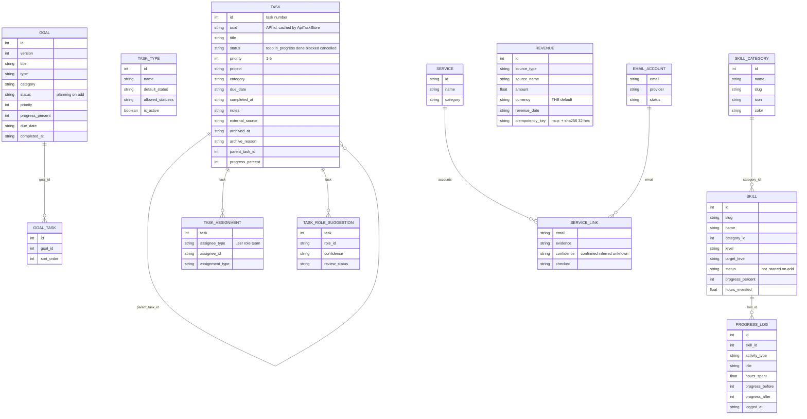

# 09 — ERD (client-side view of remote data)

Repo นี้ **ไม่มี schema หรือ migration ของตัวเอง** และไม่ได้เป็นเจ้าของข้อมูล. ERD ด้านล่างคือ shape ที่ client types และ tool code อ่าน/เขียน
บน API ปลายทาง (Tasks API, goals cell, roles-skills cell, CRM ledger) และไฟล์ `email-accounts.yaml`. Schema จริงอยู่ใน repo ของ service เหล่านั้น.
SQLite ใน `tests/support/` เป็น test double เท่านั้น (backend sqlite ถูก retire 2026-10-09).

Sources: `src/task-store.ts` (`TaskRecord`, `TaskAssignment`, `TaskTypeRecord`, `RoleSuggestion`), `src/task-state.ts` (`taskStatusSchema`), `src/cell-store.ts` (`CellRecord`), `src/tools/goals.ts`, `src/tools/skills.ts`, `src/portfolio-reads.ts` (`withCategory`), `src/tools/revenue.ts`, `src/email-accounts.ts`

Local files ที่ server อ่าน (ไม่ใช่ entity): `~/.config/empire-platform/client.env` (หรือ `$EMPIRE_CLIENT_CONFIG`), `<ops>/.runtime/automation-tokens/<name>.jwt`, `~/.config/empire-platform/tokens/<name>.jwt`, `~/.config/solo-crm/income.token`.

## Open questions
- ความหมายจริงของ `goal_id` ใน goal-tasks (FK ถึง `GOAL.id` หรือ legacy id) — โค้ดเทียบ `t.goal_id === g.id`
- Schema ของ decisions, decision reviews, bookmark proposals, free-image catalog อยู่ใน Python scripts นอก repo
