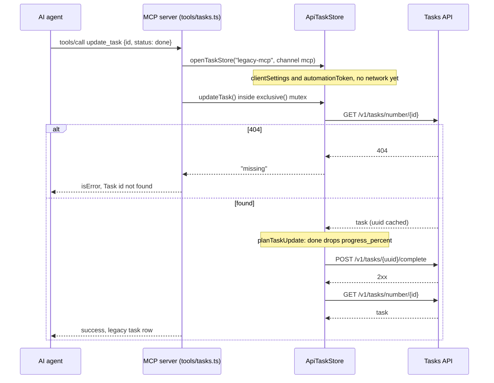
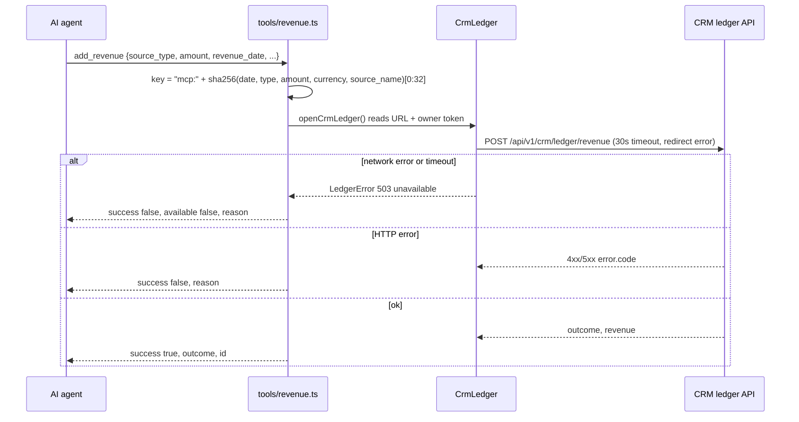
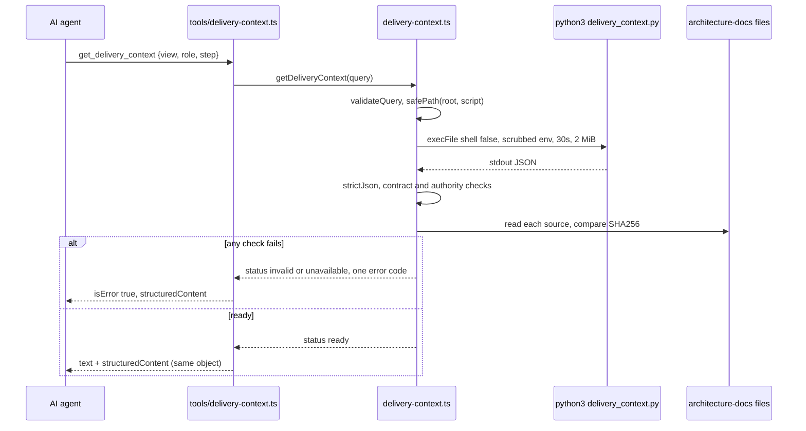
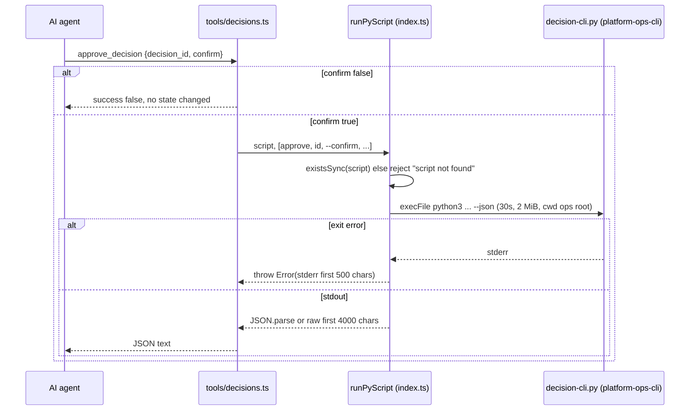

# 10 — Sequences

ไม่มี retry ในทุก path ด้านล่าง (ไม่พบ retry/backoff ใน `src/`). Error ที่ไม่ได้จับใน handler ถูก throw ออกไปให้ MCP SDK.

## S1 — `update_task` status=done

Sources: `src/tools/tasks.ts`, `src/task-state.ts`, `src/task-store.ts`

## S2 — `add_revenue` (idempotent)

Sources: `src/tools/revenue.ts`, `src/crm-ledger.ts`

## S3 — `get_delivery_context`

Sources: `src/delivery-context.ts`, `src/tools/delivery-context.ts`

## S4 — Script-backed tool (e.g. `approve_decision`)

Sources: `src/tools/decisions.ts`, `src/index.ts` (`runPyScript`)
