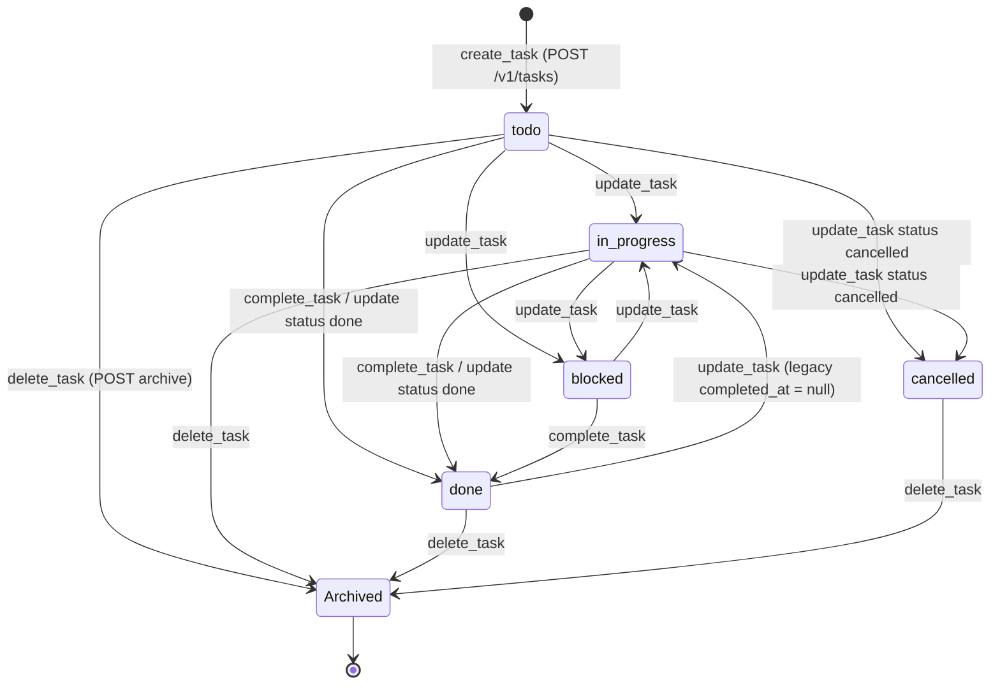
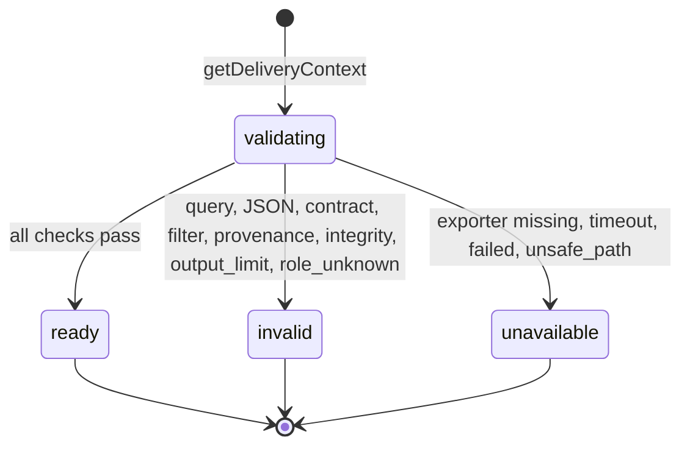
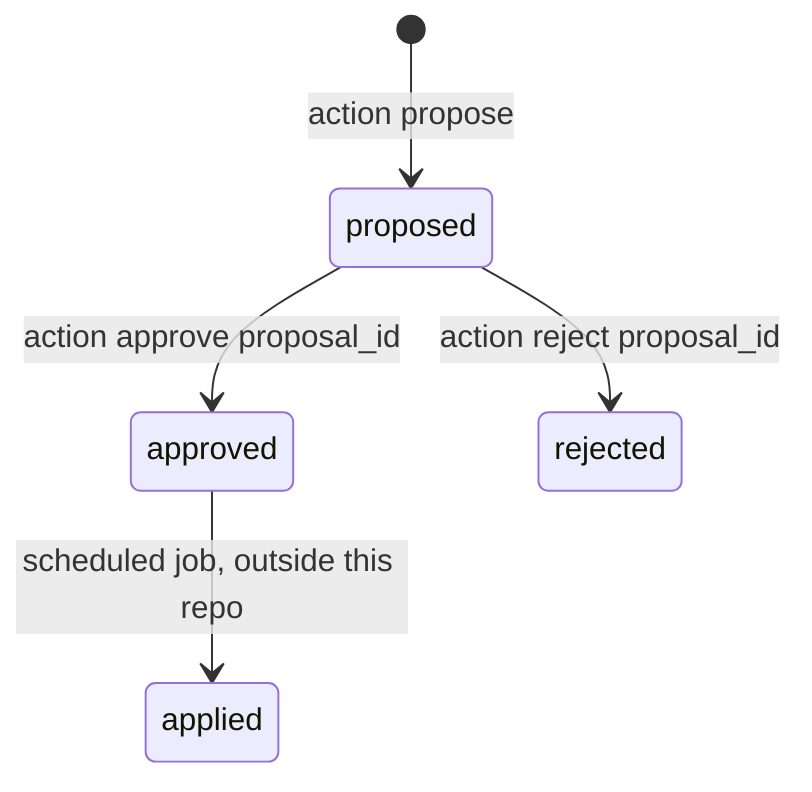

# 11 — State machines

Server ไม่บังคับ transitions เอง (API ปลายทางเป็นเจ้าของกฎ); ด้านล่างคือสิ่งที่โค้ดใน repo นี้ส่ง/รู้จักจริง.

## Task (`taskStatusSchema` + archive)

ค่า status: `todo`, `in_progress`, `done`, `blocked`, `cancelled`. `create_task` รับเฉพาะ `todo|in_progress|done|blocked`.
การเข้า `done` ใช้ `POST /complete` เสมอ (PATCH ตั้ง done ไม่ได้). ไม่มีการตรวจ allowed transition ฝั่ง client.

หมายเหตุ: create ที่ status != todo = POST แล้ว update ต่อ (ไม่ atomic). `unarchive()` มีใน `ApiTaskStore` แต่ไม่มี MCP tool เรียก. ทุกสถานะ update ได้อิสระ — เส้นที่วาดคือตัวอย่างที่ schema อนุญาต ไม่ใช่กฎที่ client บังคับ.

Sources: `src/task-state.ts`, `src/task-store.ts` (`create`, `update`, `complete`, `archive`, `unarchive`), `src/tools/tasks.ts`

## Delivery context result

Sources: `src/delivery-context.ts` (`getDeliveryContext` catch mapping, `DeliveryContextResult.status`)

## Bookmark proposal (as driven by this tool)

Sources: `src/tools/browser-bookmarks.ts`

## Goal / skill / decision
- Goal: `add_goal` ตั้ง `planning`; dashboard อ่าน `active`, `planning`; `update_goal` status เป็น free string และใส่ `completed_at` เมื่อ status = `completed`. ไม่มี enum.
- Skill: `add_skill` default `not_started`; status free string.
- Decision: actions `approve`, `reject`, `defer`, `complete`, `review` ส่งให้ `decision-cli.py`; ค่า status จริงอยู่ใน Python (ไม่อยู่ใน repo นี้).

Sources: `src/tools/goals.ts`, `src/tools/dashboard.ts`, `src/tools/skills.ts`, `src/tools/decisions.ts`

## Open questions
- Tasks API บังคับ transition อะไรบ้าง (เช่น done → cancelled) — ต้องดู repo ของ Tasks API
- ชุดค่า status ของ goals/skills/decisions เป็นทางการคืออะไร
