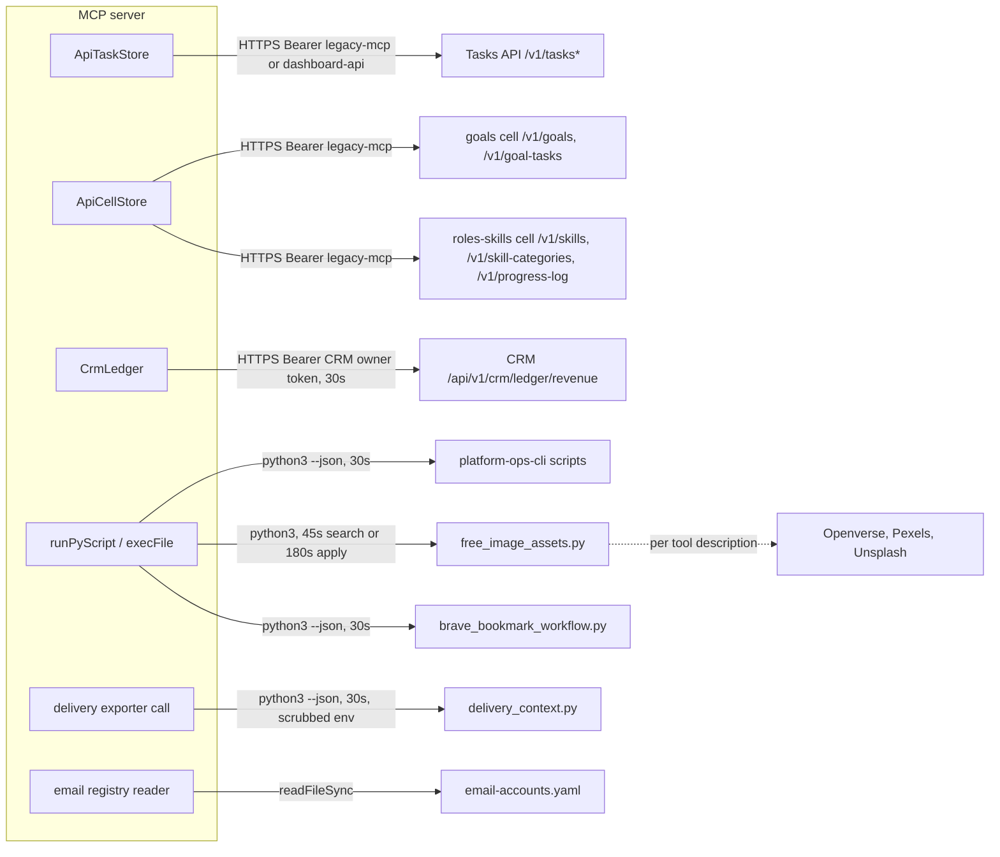

# 12 — API and integrations

## MCP surface (inbound)

Transport: JSON-RPC over stdio (`StdioServerTransport`). 40 tools:

| Module | Tools | Backend |
|---|---|---|
| `tools/tasks.ts` | `list_tasks`, `create_task`, `update_task`, `complete_task`, `delete_task`, `task_sync_status` | Tasks API, token `legacy-mcp`, channel `mcp` |
| `tools/customization.ts` | `list_task_types` | Tasks API, token `dashboard-api`, channel `mcp` |
| `tools/goals.ts` | `get_goals`, `add_goal`, `update_goal` | goals cell |
| `tools/skills.ts` | `get_skills`, `get_skill`, `add_skill`, `update_skill_progress` | roles-skills cell |
| `tools/dashboard.ts` | `get_dashboard` | roles-skills + goals cells + CRM ledger |
| `tools/revenue.ts` | `get_revenue`, `add_revenue` | CRM ledger |
| `tools/decisions.ts` | `list_decisions`, `get_decision`, `list_decision_events`, `approve_decision`, `reject_decision`, `defer_decision`, `complete_decision`, `list_decision_reviews`, `sync_decision_reviews`, `review_decision` | `cli/decision-cli.py`, `workflows/decision_review.py` |
| `tools/analytics.ts` | `revenue_analytics`, `habit_analytics`, `goal_velocity` | `utils/*.py` |
| `tools/data-freshness.ts` | `check_data_freshness` | `utils/data_freshness.py` |
| `tools/cron.ts` | `system_health` | `utils/system_health.py` |
| `tools/browser-bookmarks.ts` | `manage_brave_bookmark_proposals` | data-lake `infra/scripts/sync/brave_bookmark_workflow.py` |
| `tools/free-images.ts` | `list_free_images`, `fetch_free_images` | `utils/free_image_assets.py` |
| `tools/seo-report.ts` | `seo_report_status`, `seo_monthly_report` | `cli/seo-cli.py` |
| `tools/delivery-context.ts` | `get_delivery_context` | architecture-docs `scripts/delivery_context.py` |
| `tools/email-accounts.ts` | `list_email_accounts`, `get_account_services` | `SOLO_REGISTRY_DIR/registries/email-accounts.yaml` |

`utils/`, `cli/`, `workflows/` อยู่ใต้ `SOLO_OPS_SCRIPTS_DIR` หรือ `<SOLO_OPS_ROOT>/infra/scripts`.

## Outbound HTTP endpoints (from client code)

| Client | Base (env) | Endpoints used | Pagination | Timeout | Retry |
|---|---|---|---|---|---|
| `ApiTaskStore` | `EMPIRE_TASKS_API` | `GET /v1/tasks`, `GET /v1/tasks/number/{n}`, `POST /v1/tasks`, `PATCH /v1/tasks/{uuid}`, `POST /v1/tasks/{uuid}/complete`, `/archive`, `/unarchive`, `GET /v1/tasks/stats`, `GET /v1/task-assignments`, `GET /v1/task-types`, `GET /v1/task-role-suggestions` | cursor `after` limit 200 (tasks); offset limit 500 (assignments, suggestions) | none | none |
| `ApiCellStore` | `EMPIRE_<CELL>_API` (`EMPIRE_GOALS_API`, `EMPIRE_ROLES_SKILLS_API`) | `GET/POST /v1/{plural}`, `GET/PATCH/DELETE /v1/{plural}/{id}`, `GET /v1/{plural}/stats` | offset, limit 1000 | none | none |
| `CrmLedger` | `EMPIRE_CRM_LEDGER_API` | `GET /api/v1/crm/ledger/revenue`, `POST .../revenue` (also `invoices`, `clients` methods, unused by tools) | limit 500 | 30s `AbortSignal.timeout` | none |
| `ApiHabitsStore` | `EMPIRE_HABITS_API` | `/v1/habits`, `/v1/habits/{id}/logs/{date}`, `/v1/habit-logs`, `/v1/habits/stats` | offset 500 | none | none — not used by any MCP tool |

Headers: `Authorization: Bearer`, `X-Empire-Channel` (`mcp` from tools), `X-Correlation-Id` (fixed string per client: `task-store`, `<cell>-store`, `habits-store`; not per request). CRM client sends only Authorization. Every fetch sets `redirect: "error"`.

Sources: `src/task-store.ts`, `src/cell-store.ts`, `src/crm-ledger.ts`, `src/habits-store.ts`, `src/index.ts`, `src/tools/*.ts`, `src/delivery-context.ts`, `src/email-accounts.ts`

ไม่มี webhooks inbound และไม่มี third-party SDK อื่นนอกจาก `@modelcontextprotocol/sdk`, `zod`, `yaml` (`package.json`).

## Gaps
- ไม่มี retry ทุก client; Tasks/Cell/Habits ไม่มี timeout (hang ได้)
- `X-Correlation-Id` ไม่ unique ต่อ request — trace ข้าม service ไม่ได้
