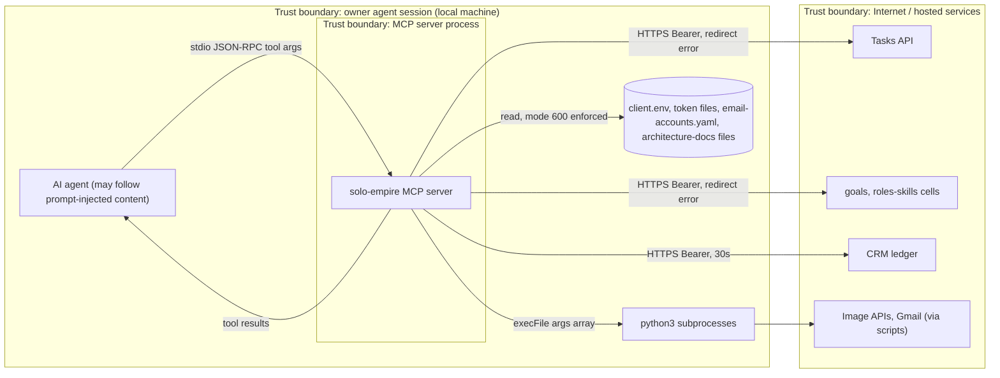

# 13 — Threat model (DFD + STRIDE)

Sources: `src/index.ts`, `src/task-store.ts`, `src/cell-store.ts`, `src/crm-ledger.ts`, `src/delivery-context.ts`, `src/email-accounts.ts`, `src/tools/*.ts`

## STRIDE

| Element | Threat | Existing mitigation (code) | Gap |
|---|---|---|---|
| stdio channel (Agent → Server) | S: any process that spawns the server acts as owner | only the local harness spawns it (`harness_mcp.py`) | no caller authentication by design |
| Agent tool args | T/E: prompt-injected agent calls write tools (`create_task`, `add_revenue`, `approve_decision`) | zod schemas; decisions need `confirm=true`; `delete_task` archives only; `sync_decision_reviews` dry-run default | `confirm` is set by the agent itself, not proven human |
| Server → Python | E: command injection | `execFile` with args array (no shell); delivery exporter `shell: false`, fixed script path, scrubbed env | `seo_monthly_report` passes caller paths `gsc`, `ahrefs`, `ga4` to the script; `fetch_free_images` query passes as positional arg — validation lives in Python |
| Server → Python | I: raw stderr in errors | delivery context returns only allowlisted codes | `runPyScript` and `fetch_free_images` reject with first 500 chars of stderr; non-JSON stdout returns `raw` first 4000 chars |
| Server → HTTPS APIs | I: token leak via redirect or http | `redirect: "error"`; `validateApiUrl` https or loopback http; URL never echoed in error | — |
| Token / config files | I: token readable by others | refuse files with group/world mode bits (`automationToken`, `readClientFile`, `ledgerToken`) | — |
| Delivery context files | T: symlink or path traversal, stale data | `safePath`, `..` and denied components rejected, SHA256 per source, strict JSON | — |
| Email registry | I: secrets in registry | reader returns Infisical paths only (by registry contract); read-only annotations | schema check is only `schema_version` |
| Decisions privacy | I: private decision text | `include_private` default false, redaction in `decision-cli.py` | redaction is outside this repo |
| Remote APIs | D: hung API blocks tool | CRM 30s timeout; subprocess timeouts 30s / 45s / 180s | Tasks/Cell fetch have no timeout |
| Concurrency | T: lost updates | `AsyncMutex` per Tasks API base URL in `exclusive()` (tested) | lock is in-process only; two server processes can still race |
| Repudiation | R: who changed what | Tasks/Cell requests send `X-Empire-Channel: mcp`; token identity on server side | no local audit log; correlation id is a fixed string |
| Dependencies | T: supply chain | CI `security` job: gitleaks, semgrep, osv-scanner, trivy-fs; Renovate; `hono` override 4.13.11 | security job red on last 2 main runs (osv-scanner, trivy-fs) |

Sources: เหมือนด้านบน, `.github/workflows/ci.yml`, `renovate.json`, `package.json`, `tests/task-store.test.ts`, `tests/task-lifecycle.test.ts`

## Open questions
- ควรมี human-in-the-loop จริงสำหรับ `approve_decision` (เช่น confirm จาก owner channel) หรือยอมรับ agent-confirm
- สาเหตุที่ osv-scanner และ trivy-fs fail บน main (2026-10-28) — log ดึงไม่ได้ตอนเขียน (TLS timeout)
