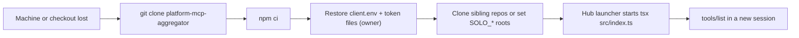

# 14 — Backup and DR

Server นี้ stateless: ไม่มี DB, ไม่มีไฟล์ที่ตัวเองเขียน (ยกเว้นผ่าน Python scripts เมื่อ `apply=true`/`confirm=true`). ข้อมูลทั้งหมดอยู่ที่ระบบปลายทาง.

| Data | Owner / location | Written by this repo? | Backup reality |
|---|---|---|---|
| Tasks, assignments, task types | Tasks API | yes (create/update/complete/archive) | not in this repo; ดู repo ของ Tasks API |
| Goals, goal-tasks | goals cell | yes (add/update) | not in this repo |
| Skills, categories, progress-log | roles-skills cell | yes (add/update/log) | not in this repo |
| Revenue | CRM ledger | yes (`add_revenue`) | not in this repo |
| Decisions, reviews | via `decision-cli.py` / `decision_review.py` | indirectly | unknown (Python repo) |
| Bookmark proposals | data-lake-pipelines workflow | indirectly | unknown |
| Free images `media/references/free-stock/` | via `free_image_assets.py` (path from tool description) | indirectly | unknown |
| SEO packs | via `seo-cli.py` | indirectly | unknown |
| Client config and tokens | owner home / ops `.runtime` | no (read only) | owner-managed |
| Source code | GitHub `bookchaowalit/platform-mcp-aggregator` | — | Git |

Sources: `src/**`, `README.md`, `PRODUCT.md`, `~/solo-empire/infra/scripts/agent/harness_mcp.py` (read-only)

- RTO / RPO: not defined (ไม่มีในเอกสาร repo). สำหรับ server เอง RPO ไม่เกี่ยว (ไม่มี state).
- ไม่มี backup workflow ใน `.github/workflows/`.

## Open questions
- Backup ของ Tasks API / cells / CRM ถูกกำหนดที่ไหน (นอก repo นี้)
