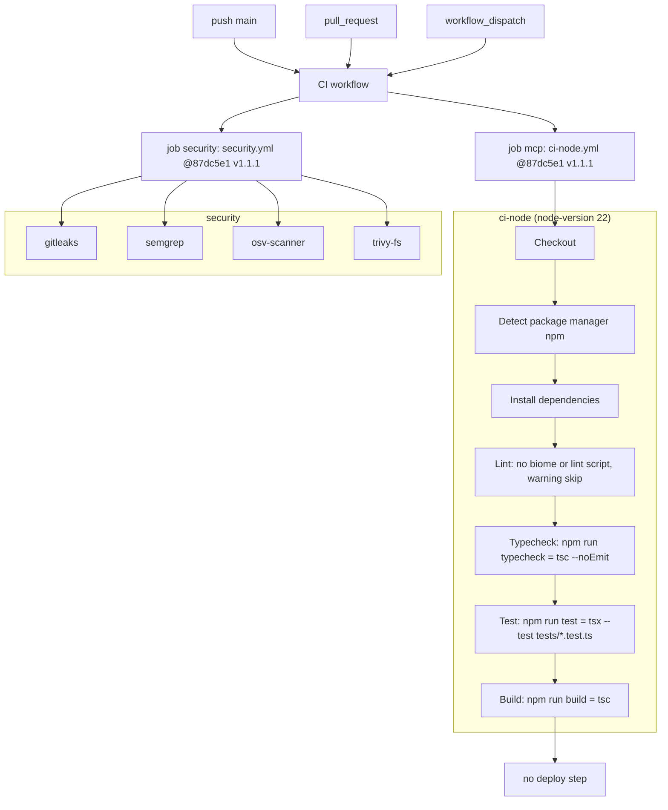

# 15 — CI/CD pipeline

Workflow เดียว: `.github/workflows/ci.yml` (`CI`). Triggers: `push` to `main`, `pull_request`, `workflow_dispatch`. `permissions: contents: read`; concurrency `ci-${{ github.ref }}` cancel-in-progress. Runners: GitHub-hosted (public repo, comment หัวไฟล์). ไม่มี CD job.

Sources: `.github/workflows/ci.yml`, `package.json` (scripts), reusable workflow `bookchaowalit/platform-ci-workflows/.github/workflows/ci-node.yml` and `security.yml` (local clone read for step names; pinned SHA `87dc5e1c7e04` in ci.yml)

ไม่มี `needs` ระหว่าง jobs (รันขนาน). ไม่ได้ส่ง `coverage-threshold` จึงไม่มี coverage gate. Tests ที่ต้องใช้ `platform-ops-cli` หรือ `architecture-docs` จะ skip บน CI.

## สถานะล่าสุด (`gh run list -R bookchaowalit/platform-mcp-aggregator`, 2026-11-04)

| Date (UTC) | Event | SHA | Result | Failing jobs |
|---|---|---|---|---|
| 2026-10-28 16:10 | push main | `336bcea` | failure | security/trivy-fs, security/osv-scanner |
| 2026-10-28 15:51 | push main | `e473a12` | failure | security/trivy-fs, security/osv-scanner |
| 2026-10-22 09:46 | push main | `53a3fae` | success | — |
| 2026-10-22 09:31 | push main | `624fe84` | failure | security/osv-scanner |
| 2026-10-17 09:30 | push main | `0d666f3` | success | — |
| 2026-10-17 09:15 | pull_request #1 | `55ca9df` | success | — |

`mcp / node (.)` ผ่านทุก run ที่ตรวจ. Dependency updates: Renovate (`renovate.json`) ทุกวันจันทร์ก่อน 9 โมง (Asia/Bangkok), lockfile maintenance วันที่ 1.

## Open questions
- สาเหตุ osv-scanner / trivy-fs fail บน `336bcea` (log fetch timeout ตอนเขียน)
