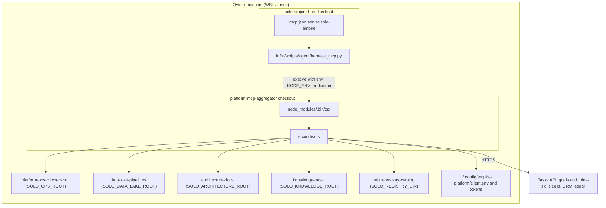

# 16 — Deployment

ไม่มี hosted deployment (`PRODUCT.md`: "Not deployed"; `README.md`: "ยังไม่มี target สำหรับ hosted deployment"). "Deployment" คือ checkout บนเครื่อง owner ที่ hub launcher เรียก. ไม่มี domain, ไม่มี container.

Sources: `~/solo-empire/.mcp.json`, `~/solo-empire/infra/scripts/agent/harness_mcp.py` (read-only, hub), `src/roots.ts`, `src/task-store.ts`, `README.md`, `PRODUCT.md`

Release step สำหรับ owner: `git pull` + `npm ci` ใน checkout แล้ว restart session และตรวจ `tools/list` (`README.md`). Launcher พิมพ์ "MCP dependencies are missing; run npm ci ..." ถ้าไม่มี `tsx` หรือ `src/index.ts`.

| Env | ใช้ที่ไหน |
|---|---|
| `SOLO_MCP_ROOT`, `SOLO_OPS_ROOT`, `SOLO_ARCHITECTURE_ROOT`, `SOLO_KNOWLEDGE_ROOT`, `SOLO_DATA_LAKE_ROOT` | launcher ใส่ default เป็น sibling checkouts |
| `SOLO_REGISTRY_DIR` | launcher ใส่ `<hub>/repository-catalog` |
| `SOLO_OPS_SCRIPTS_DIR`, `PYTHON` | optional overrides (`src/roots.ts`, `src/index.ts`) |
| `SOLO_EMPIRE_TASKS_BACKEND`, `EMPIRE_*_API`, `EMPIRE_CLIENT_CONFIG`, `EMPIRE_AUTOMATION_TOKEN_*`, `EMPIRE_CRM_LEDGER_TOKEN` | env หรือ client file / token files (`src/task-store.ts`, `src/crm-ledger.ts`) |

`package.json` มี `publishConfig.registry` = GitHub Packages แต่ไม่มี workflow publish และ launcher รันจาก `src/` ผ่าน `tsx` ไม่ใช่ `dist/`.
