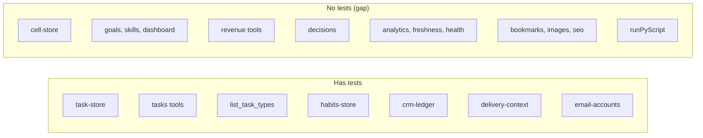

# 17 — Test coverage matrix

Runner: `node:test` ผ่าน `tsx --test tests/*.test.ts` (6 test files). Test doubles: `tests/support/sqlite-task-store.ts`, `sqlite-cell-store.ts`, `run-cli-with-sqlite-tasks.ts`. "Integration" = MCP `Client` + `InMemoryTransport` เรียก tool จริง หรือ subprocess จริง. ไม่มี e2e กับ API จริง (ตั้งใจ). ไม่มี coverage tool/threshold.

| Feature / module | Unit | Integration (MCP in-memory or subprocess) | E2E | Test file |
|---|---|---|---|---|
| Task store API client (requests, pagination, errors, redirects, tokens, client config) | yes | — | no | `tests/task-store.test.ts` |
| Task tools (`list/create/update/complete/delete_task`, `task_sync_status`) | yes (`planTaskUpdate`) | yes (MCP tools on SQLite double, concurrency) | no | `tests/task-lifecycle.test.ts` |
| `list_task_types` | — | yes ("keeps its old output") | no | `tests/task-store.test.ts` |
| Owner CLI task commands | — | conditional (skip without `platform-ops-cli`) | no | `tests/task-lifecycle.test.ts` |
| Habits store client | yes | — | no | `tests/habits-store.test.ts` |
| CRM ledger client | yes | — | no | `tests/crm-ledger.test.ts` |
| Delivery context | yes | yes (MCP `tools/list` + `callTool`; real exporter/CLI conditional skips) | no | `tests/delivery-context.test.ts` |
| Email accounts | yes | yes (MCP) | no | `tests/email-accounts.test.ts` |
| Cell store client (`ApiCellStore`) | **gap** | — | no | none |
| Goals tools | **gap** | **gap** | no | none |
| Skills tools | **gap** | **gap** | no | none |
| Dashboard | **gap** | **gap** | no | none |
| Revenue tools (`get_revenue`, `add_revenue` idempotency key) | **gap** (client only) | **gap** | no | none |
| Decisions tools (`confirm` gate) | **gap** | **gap** | no | none |
| Analytics, data freshness, system health | **gap** | **gap** | no | none |
| Bookmarks, free images, SEO | **gap** | **gap** | no | none |
| `runPyScript` (missing script, timeout, non-JSON) | **gap** | **gap** | no | none |
| `roots.ts` | partial (architecture root) | — | no | `tests/delivery-context.test.ts` |

Sources: `tests/*.test.ts`, `tests/support/*.ts`, `package.json` (`test`), `src/tools/*.ts`

สรุป: 15 tool modules → 4 มี tool-level test (tasks, customization, delivery-context, email-accounts) = 11 modules / 30 tools ยังไม่มี (เทียบเป้า PRODUCT.md "0 untested tools").
