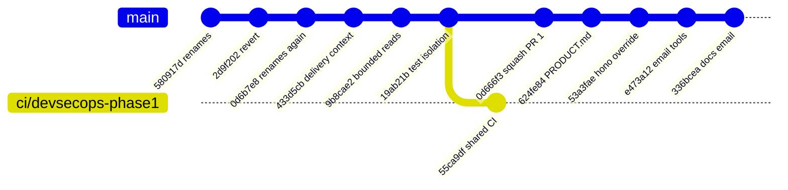
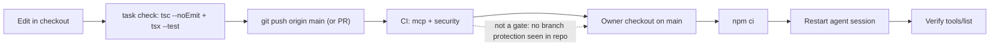

# 18 — Git and release workflow

ประวัติ 90 วัน (ตั้งแต่ 2026-08-06): 56 commits บน `main`, 53 first-parent, PR ทั้งหมด 1 อัน (#1 `ci/devsecops-phase1`, squash-merged เป็น `0d666f3` 2026-10-17; history ช่วงหลังบน main เป็นเส้นตรง). ส่วนใหญ่ push ตรงเข้า `main`. ไม่มี tags/releases. "Production" = owner pull checkout แล้ว restart session.

Sources: `git log origin/main`, `gh pr list -R bookchaowalit/platform-mcp-aggregator --state all`, `.github/workflows/ci.yml`, `Taskfile.yml`, `README.md`

หมายเหตุ: hub AGENTS.md ระบุ Codex review Stop hook ใน session ของ Claude Code — เป็น policy ของ harness ไม่ใช่ของ repo นี้.

## Open questions
- มี branch protection / ruleset บน `main` หรือไม่ (ไม่เห็นในไฟล์ repo)
- จะมี versioning (package `version` ยัง `1.0.0`, server version `1.0.0`) หรือไม่
