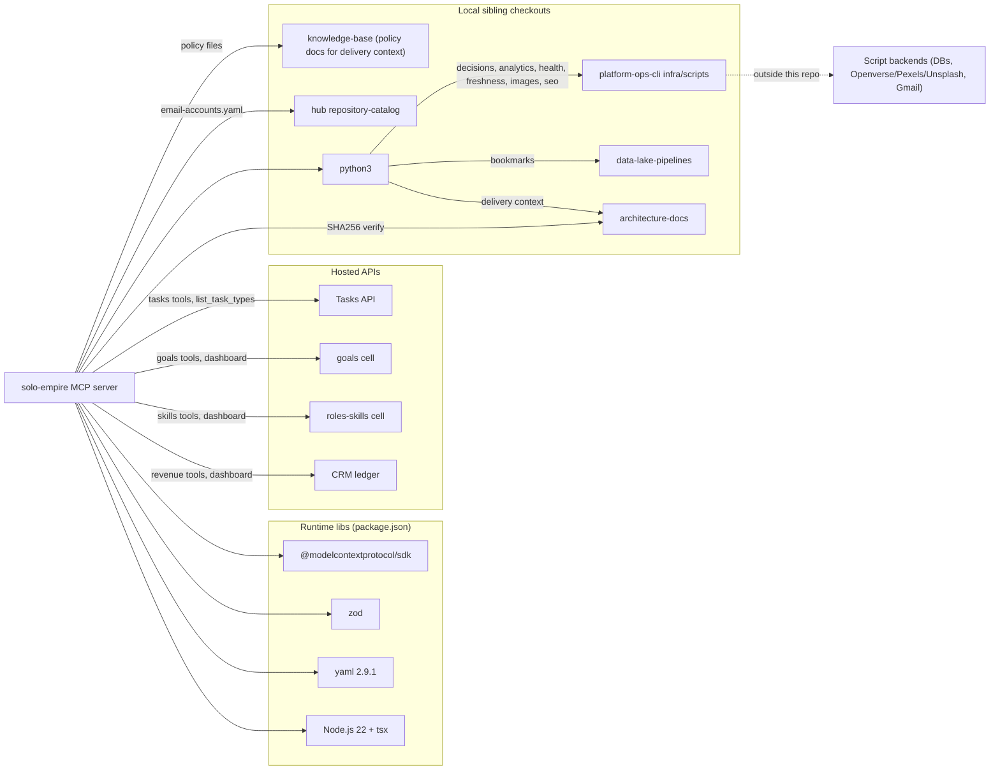

# 19 — Service dependency map

Sources: `package.json`, `src/index.ts`, `src/roots.ts`, `src/tools/*.ts`, `src/delivery-context.ts` (`knowledgeRoot`, `KNOWLEDGE_PATHS`), `src/email-accounts.ts`

Reverse dependency: `platform-ops-cli` owner CLI ใช้ `src/task-store.ts` และ `src/delivery-context.ts` จาก repo นี้ (comment ใน `src/task-store.ts`, `src/delivery-context.ts` `parseDeliveryCliArgs`, tests ที่ spawn `infra/cli.ts`).

| Dependency | Failure behaviour in code |
|---|---|
| Tasks / cell API down | fetch throws; no timeout; error propagates to SDK |
| CRM down | `LedgerError 503` → `available:false` in `get_revenue` / dashboard; `add_revenue` returns `success:false` |
| Script missing | `script not found ...` error (runPyScript); bookmarks: explicit message; delivery: `exporter_unavailable` |
| Registry dir unset | `SOLO_REGISTRY_DIR is not set ...` isError |
