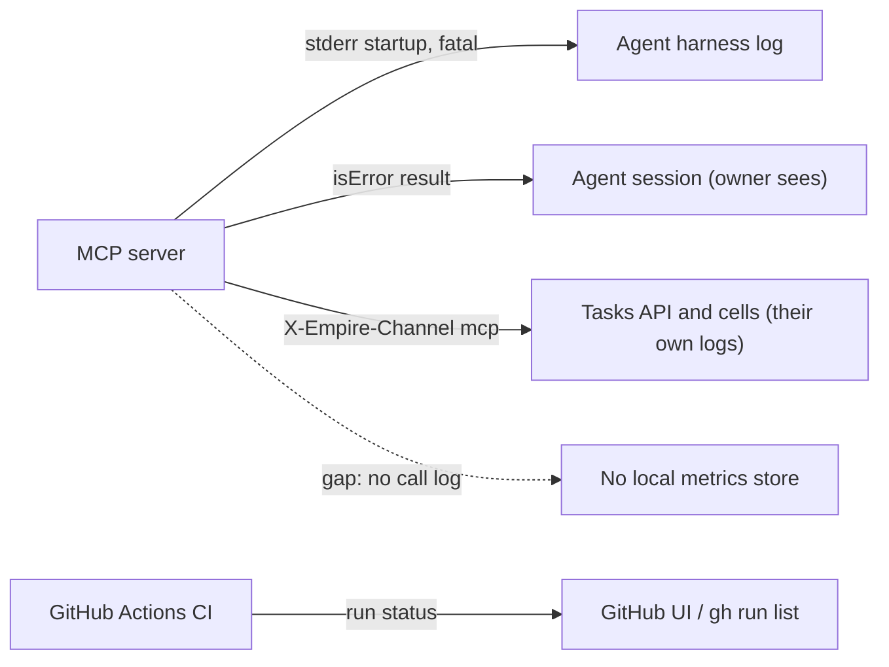

# 20 — Observability

Instrumentation จริงใน repo มีน้อยมากโดยตั้งใจ (ADR-0003): ไม่มี Sentry, PostHog, metrics, tracing, uptime หรือ heartbeat.

| Signal | Implemented? | Where |
|---|---|---|
| Startup line `Solo Empire MCP Server running on stdio` (stderr) | yes | `src/index.ts` |
| Fatal error `Fatal error:` + exit 1 (stderr) | yes | `src/index.ts` |
| Tool error results (`isError`, error codes) shown in agent session | yes | `src/tools/tasks.ts`, `delivery-context.ts`, `email-accounts.ts` |
| `X-Empire-Channel: mcp` header for server-side attribution | yes (Tasks, cells) | `src/task-store.ts`, `src/cell-store.ts` |
| `X-Correlation-Id` | fixed string per client, not per call | `src/task-store.ts`, `src/cell-store.ts`, `src/habits-store.ts` |
| Per-call log / unexpected-error rate | **gap** (PRODUCT.md `[ต้องยืนยัน]`) | — |
| Sentry / PostHog | **not applicable by decision** | `PRODUCT.md` |
| Uptime / heartbeat | **not applicable** (no hosted process) | — |
| CI status | yes (GitHub Actions) | `.github/workflows/ci.yml` |
| `system_health` / `check_data_freshness` tools | expose other systems' health, not this server's | `src/tools/cron.ts`, `src/tools/data-freshness.ts` |

Sources: `src/index.ts`, `src/tools/*.ts`, `src/task-store.ts`, `src/cell-store.ts`, `src/habits-store.ts`, `PRODUCT.md`, `.github/workflows/ci.yml`

## Open questions
- Hub harness เก็บ stderr ของ MCP server ไว้ที่ไหน (นอก repo)
