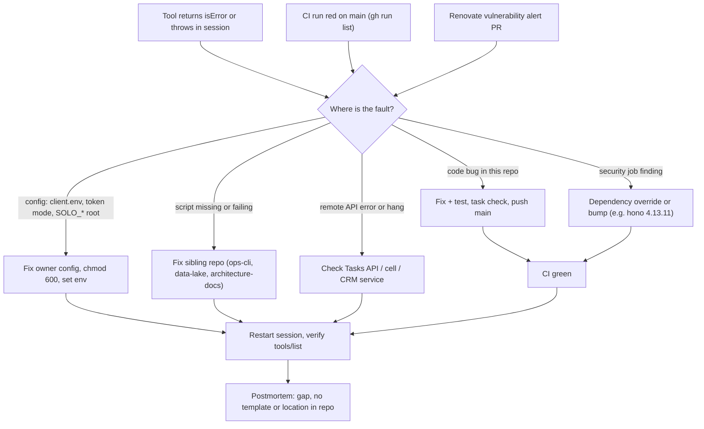

# 21 — Incident response

ไม่มี alert channel อัตโนมัติสำหรับ repo นี้ (ไม่มี Sentry, Telegram, uptime ใน code/workflows). "Alerts" ที่มีจริง: tool error ใน agent session, CI failure บน GitHub, Renovate vulnerability PRs (label `security`).

Sources: `src/index.ts`, `src/task-store.ts` (error messages for config/token mode), `src/crm-ledger.ts`, `README.md`, `.github/workflows/ci.yml`, `renovate.json`, commit `53a3fae` (example dependency fix)

## Open questions
- ไม่มี postmortem template/ที่เก็บ — ใช้ของ architecture-docs หรือไม่
- CI ที่ red บน `main` ตั้งแต่ 2026-10-28 ยังไม่มีใครรับ (ดู 15)
