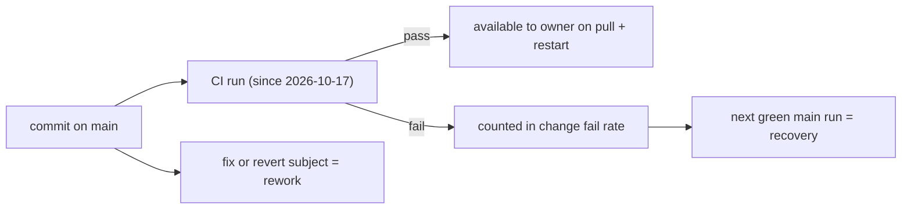

# 22 — DORA metrics

ข้อจำกัดหลัก: repo นี้ **ไม่มี deployment** (local stdio, ไม่มี CD job, ไม่มี tags/releases). จึงใช้ proxy: "deployment" = commit ที่เข้า `main` (owner ได้มันเมื่อ pull + restart). ช่วงวัด: 90 วัน 2026-08-06 → 2026-11-04. CI มีตั้งแต่ 2026-10-17 เท่านั้น.

| Metric | วิธีวัดสำหรับ repo นี้ | ค่า (90 วัน) | Command |
|---|---|---|---|
| Deployment frequency | proxy: first-parent commits เข้า `main` | 53 (56 รวม merge parents), active 11 สัปดาห์ ≈ 4.1/week | `git log origin/main --since=2026-08-06 --first-parent --format=%h \| wc -l`; สัปดาห์: `git log origin/main --since=2026-08-06 --format=%ad --date=format:%G-W%V \| sort -u \| wc -l` |
| Lead time for changes | proxy: author time → commit time บน main; PR merge time | median 0 h (push ตรง); PR #1: 15 นาที (09:15:52 → 09:30:40 UTC) | `git log origin/main --since=2026-08-06 --format='%at %ct'`; `gh pr list -R bookchaowalit/platform-mcp-aggregator --state all --json createdAt,mergedAt` |
| Change fail rate | proxy: push-to-main CI runs ที่ fail / ทั้งหมด (มีข้อมูลตั้งแต่ 2026-10-17) | 3/5 = 60% (ทุกครั้งเป็น job `security`; `mcp` ผ่านหมด) | `gh run list -R bookchaowalit/platform-mcp-aggregator -L 200 --json event,conclusion,headBranch` |
| Failed deployment recovery time | proxy: เวลาจาก main run แรกที่ fail ถึง main run ถัดไปที่ผ่าน | `624fe84` 2026-10-22 09:31 → `53a3fae` 09:46 = 15 นาที; failure ตั้งแต่ 2026-10-28 15:51 ยังไม่ recover (≥ 7 วัน ณ 2026-11-04) | same `gh run list` |
| Deployment rework rate | proxy: commits ที่เป็น fix/revert ต่อ commits บน main | 7/56 ≈ 12.5% (`53a3fae`, `9b8cae2`, `2d9f202` revert, `6dfd822`, `8f6a6f1`, `50b40e4`, `4cdaa32`) | `git log origin/main --since=2026-08-06 --format='%h %ad %s' --date=short \| grep -i 'revert\|fix'` |

Sources: `git log origin/main`, `gh run list -R bookchaowalit/platform-mcp-aggregator`, `gh pr list -R bookchaowalit/platform-mcp-aggregator --state all`, `.github/workflows/ci.yml`

หมายเหตุ rework grep นับ `6dfd822` ("follow the repository rename") เพราะ subject มีคำว่า "prefix" ที่มี "fix" — ถ้าตัดออกเหลือ 6/56 ≈ 10.7%.

## Not computable
- Deployment frequency / lead time / recovery แบบจริง (ถึง production) — ไม่มี deploy event; ไม่รู้ว่า owner pull เมื่อไร
- Change fail rate ก่อน 2026-10-17 — ไม่มี CI
